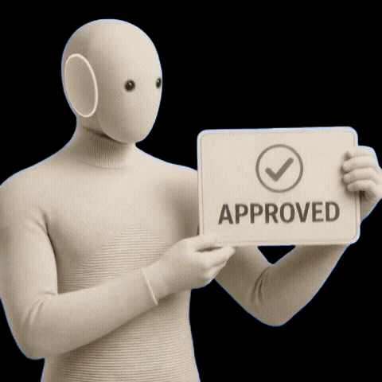

# SnipGIF — free background remover for GIFs, images & short video, 100% in your browser

Drop a GIF, an animated WebP, a still image (PNG/JPG/WebP) or a short video
(MP4/WebM, up to 60 seconds) and get your
character back with the background cut clean — frame by frame, like a
rotoscope. Export a transparent GIF, a transparent PNG sequence (`.zip`) or
an alpha WebM. Queue up to 5 files as a batch (one model download for all
of them, one `.zip` back), and optionally bake in a sticker effect —
wobble, shake or bounce — before you export.

**Live version: https://blob.blob16exe.workers.dev/snipgif/**

 

## Why it exists

Hosted background removers cap free clips at a few seconds, stamp a
watermark, and only let you process one clip at a time. SnipGIF runs the
same open-source AI models they use — **u2net** and **ISNet**, the models
behind the open-source [rembg](https://github.com/danielgatis/rembg)
project — entirely in your browser instead:

- **No uploads.** Your file never leaves your device. There is no server.
- **No watermark, no sign-up, no per-clip limits** beyond what your
  browser can hold in memory.
- **Nothing to install.** No Python, no rembg, no dependencies — just a
  modern browser. (The hosted rembg tool needs a Python stack; this page
  re-implements rembg's exact preprocessing math in JavaScript and runs
  the same ONNX models with onnxruntime-web.)

## How to use

1. Open the [live page](https://blob.blob16exe.workers.dev/snipgif/) — or
   run this repo locally (below).
2. Drop a GIF / image / animated WebP / short MP4 or WebM onto the page.
3. Pick a mode:
   - **AUTO** — looks at the middle frame; dark scenes go to ISNet,
     everything else to u2net.
   - **PERSON + PROPS (u2net)** — best at people holding things.
   - **DARK SCENE (ISNet)** — better on dark, detailed scenes.
4. Hit **REMOVE BACKGROUND**, watch the before/after preview, then
   download the PNG sequence or the alpha WebM.

### Run it locally

The page is fully static, but browsers will not load the module scripts
and WASM from `file://` — serve the folder with any static server:

```sh
cd snipgif
python3 -m http.server 8000
# then open http://localhost:8000
```

(`npx serve .` works too.) Internet access is still needed on first use:
the libraries load from the jsDelivr CDN and the AI model downloads once
(see below).

## How it works

1. **Frame extraction** — GIF via gifuct-js; animated WebP via the
   browser's ImageDecoder API with a libwebp-WASM fallback; still images
   (PNG/JPG) via an  decode into a single frame; MP4/WebM by
   seek-stepping a `<video>` element.
2. **Per-frame segmentation** — onnxruntime-web (WASM) runs u2net
   (320×320) or ISNet (1024×1024) on every frame, replicating rembg's
   preprocessing exactly (per-frame max scaling, the models' mean/std,
   mask min-max normalisation).
3. **Composite + export** — the predicted mask becomes the alpha channel;
   export as a transparent GIF (gifenc), a PNG sequence in a `.zip`
   (JSZip) or an alpha WebM (WebCodecs + webm-muxer; needs a recent
   Chrome). An optional sticker effect (wobble / shake / bounce) is
   applied by one shared transform before encoding, so the preview and
   every export agree frame by frame.

Limits: ~15 s of animation, max 120 frames, frames wider than 1280 px
are downscaled, max 5 files per batch.

## The model download (read this before you fork)

Each model is a **one-time download of ~170 MB** (u2net: 175,997,641
bytes; ISNet: 178,648,008 bytes), then cached by your browser.

- In **this repo**, the loader first tries `./assets/models/` and then
  automatically falls back to two Hugging Face mirrors of the official
  rembg models
  ([tomjackson2023/rembg](https://huggingface.co/tomjackson2023/rembg),
  [lucasfaesa/rembg-models](https://huggingface.co/lucasfaesa/rembg-models)).
  The files are byte-identical to rembg's official release (MD5s
  `60024c5c889badc19c04ad937298a77b` / `fc16ebd8b0c10d971d3513d564d01e29`).
- On the **live Blob site** the models are self-hosted instead: each one
  is split into 9 chunks of 20 MiB under `assets/models/`
  (`u2net.part00`…`u2net.part08`, `isnet.part00`…`isnet.part08`) because
  Cloudflare Pages caps single files at 25 MB. To do the same, download
  the `.onnx` files from the mirrors above, split them into 20 MiB
  parts with that naming, and drop them into `assets/models/` — no code
  change needed.

## Tech notes

- onnxruntime-web 1.20.1, pinned on jsDelivr. `numThreads` adapts: the
  live Blob site sends COOP/COEP headers for `/snipgif/` only (a
  `_headers` file), making the page cross-origin isolated, so the WASM
  runtime uses up to 4 threads there; anywhere else it stays at 1.
- gifuct-js 2.1.2, JSZip 3.10.1, webm-muxer 5.1.2, libwebp-wasm 0.1.6,
  gifenc 1.0.3 — all pinned, all loaded from jsDelivr at runtime.
- WebM alpha export needs WebCodecs VP9-alpha encoding (recent Chrome).
  The PNG sequence works in every browser and every editor.
- Best on desktop; phones work, just slower (the model download plus a
  1024×1024 model is heavy for a phone).
- Page chrome (nav/footer styles) is loaded from the live Blob site so
  this repo stays focused on the tool itself; the tool's own stylesheet
  is `snipgif.css`.

## Credits

- [rembg](https://github.com/danielgatis/rembg) by Daniel Gatis — the
  models and the preprocessing this page replicates.
- [U²-Net](https://github.com/xuebinqin/U-2-Net) (Qin et al.) and
  [ISNet / DIS](https://github.com/xuebinqin/DIS) (Qin et al.).
- Libraries: [ONNX Runtime Web](https://onnxruntime.ai/),
  [gifuct-js](https://github.com/matt-way/gifuct-js),
  [JSZip](https://stuk.github.io/jszip/),
  [webm-muxer](https://github.com/Vanilagy/webm-muxer),
  [libwebp-wasm](https://www.npmjs.com/package/libwebp-wasm).

## License

MIT — see [LICENSE](LICENSE). The AI models are **not** covered by this
license; they belong to their respective projects (u2net / ISNet, via
rembg).
